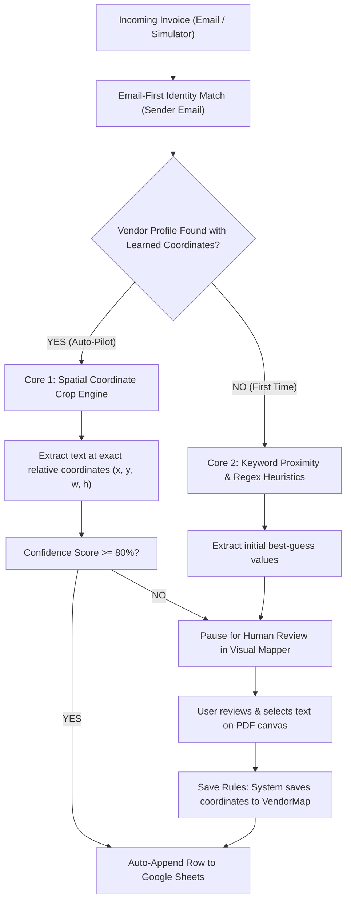

# PDF2Sheet Auto — Intelligent Invoice Extraction & Cloud Sync

<p align="center">
  
  
  
  
  
  
  
  
</p>

**PDF2Sheet Auto** is a full-stack automated invoice extraction platform that ingests unstructured PDF invoices from email inboxes, parses key financial metadata using a dual-core spatial OCR engine, and synchronizes clean records in real time to Google Sheets.

Rather than relying purely on static heuristics or expensive LLM tokens for every document, PDF2Sheet features a **human-in-the-loop spatial learning engine**: correct a vendor's field once on the interactive PDF canvas, and the system permanently memorizes the exact coordinate bounding boxes for zero-touch auto-pilot processing forever after.

---

## What's New in UI/UX 2.0

The application has been overhauled with a modern, fintech-grade design system (Linear & Stripe inspired) and features built specifically for rapid technical evaluation:

### 1. 📊 Invoices Command Center
- **4-KPI Metric Strip**: Live financial throughput counter (parsed volume `$XX,XXX.XX`), zero-touch auto-pilot sync rate `%`, total invoice count, and urgent review queue alerts.
- **Filter & Search Toolbar**: Real-time multi-field search (vendor, invoice #, amount, email) paired with quick status filter tabs (`All`, `Auto-Pilot`, `Needs Review`) and sorting.
- **Slide-Over Quick Preview Drawer (`InvoiceDrawer`)**: Click any invoice row to inspect confidence scores, review captured dates and amounts, copy metadata with one click, or approve straight to Google Sheets without leaving the dashboard.
- **Client-Side Export Engine**: 1-click **Export to CSV** or **Export to JSON** for all or selected invoice batches.
- **Batch Operations**: Checkbox selection for bulk deletions and targeted data exports.

### 2. 🎯 Visual Coordinate Mapper (Interactive OCR Workstation)
- **Dual-Pane Document Stage**: High-performance PDF viewport with zoom controls (In/Out, 1:1 Reset, Fit-to-Viewport) and page navigation.
- **Active Target HUD**: Real-time crosshair guide that links active target fields (`Invoice #`, `Date`, `Total Amount`, `Due Date`) to highlighted text on the vector canvas.
- **Click-to-Learn Bounding Boxes**: Selecting text on the invoice captures spatial coordinates (`x`, `y`, `width`, `height`), teaches the vendor profile, and auto-advances to the next field.
- **Live Google Sheet Row Mirror**: An embedded spreadsheet table preview updating in real time as values are mapped, showing the exact row to be committed.

### 3. ⚡ 1-Click Interactive Demo Sandbox (DevTools Simulator)
- **Zero-Setup Recruiter Presets**: Test end-to-end automation with pre-packaged realistic commercial invoice scenarios:
  - **Stripe Payments** (`billing@stripe.com` · $1,420.00)
  - **AWS Cloud Services** (`no-reply-aws@amazon.com` · $2,845.50)
  - **GitHub Enterprise** (`billing@github.com` · $420.00)
- **Real-Time 4-Stage Pipeline Visualizer**: An animated execution stepper displaying the live lifecycle of an invoice:
  `[1] IMAP Ingestion` ➔ `[2] Email-First Identity` ➔ `[3] Dual-Core OCR` ➔ `[4] Google Sheets Dispatch`.
- **Drag-and-Drop Ingestion Dropzone**: Upload any custom PDF file with autofill email chips for custom scenario testing.

### 4. 🧠 Discovered Vendors & Spatial Coordinate Hub
- **Learned Rules Directory**: Visual breakdown of all discovered email identities and their active spatial coordinate bounding boxes.
- **Heuristic vs. Coordinate Breakdown**: Inspect rule method, coordinates (`x`, `y`), and confidence ratings.
- **1-Click Test Shortcuts**: Launch simulator tests directly from any vendor card.

### 5. 🎨 Design System & Theme Architecture
- **Unified `ThemeContext`**: Single reactive state managing dark/light modes with automatic DOM class binding and persistent storage.
- **Tailwind CSS v4 Design Tokens**: Obsidian slate backgrounds (`#0B0F19`, `#111827`, `#1E293B`) accented by electric violet (`#8B5CF6`), emerald auto-pilot badges (`#10B981`), and cyan spatial OCR tags (`#06B6D4`).
- **Smooth Micro-Interactions**: Framer Motion spring drawers, interactive cursor feedback, and toast notifications.

---

## How It Works: The Dual-Core Engine



1. **Email-First Identity**: Rather than trying to parse ambiguous vendor logos, the system matches the sender's email domain (e.g. `billing@stripe.com`).
2. **Core 1 — Coordinate Learning (High Precision)**: If extraction rules exist for that vendor, the engine extracts text at the exact relative spatial coordinates on the page.
3. **Core 2 — Proximity Heuristics (Cold Start)**: For new vendors, the engine scans the document looking for anchored keywords (`Invoice Number:`, `Total Due:`, `Date:`) and cleans the extracted numbers and dates.
4. **Human-in-the-Loop Feedback Loop**: Any manual correction in the Visual Mapper stores the bounding box coordinates into MongoDB for subsequent invoices from that vendor.

---

## Tech Stack

| Layer | Technologies |
|---|---|
| **Frontend** | React 19, Vite 7, Tailwind CSS v4, Framer Motion, TanStack Query v5, React Router v7, Lucide Icons, React-PDF, React Hot Toast |
| **Backend** | Node.js, Express 5, Mongoose 9, Multer (in-memory buffer parsing) |
| **PDF & OCR** | `pdf2json` (vector text & coordinate positioning), `pdf-lib` (binary PDF generation) |
| **Database** | MongoDB Atlas |
| **Integrations** | Google Sheets API v4 (OAuth2 offline refresh token sync), Node-IMAP |
| **Authentication** | JWT (JSON Web Tokens), Google OAuth2 |

---

## Repository Structure

```
pdf2sheet/
├── frontend/
│   ├── public/
│   │   └── samples/                 # Preset test invoice PDFs (Stripe, AWS, GitHub)
│   ├── src/
│   │   ├── components/
│   │   │   ├── common/              # ConfirmationModal, TextReveal, CustomCursor
│   │   │   ├── invoices/            # InvoiceDrawer (slide-over preview)
│   │   │   ├── layout/              # Sidebar, Header, MainLayout
│   │   │   ├── Review/              # VisualMapper (dual-pane OCR workstation)
│   │   │   ├── settings/            # GoogleSheetsSection, ProfileSection
│   │   │   ├── ui/                  # Button, Input
│   │   │   └── vendors/             # AddVendorModal, EditVendorModal
│   │   ├── contexts/
│   │   │   └── ThemeContext.jsx     # Centralized Dark/Light theme provider
│   │   ├── pages/
│   │   │   ├── auth/                # Login, Register, GoogleAuthCallback
│   │   │   ├── dashboard/           # Invoices Command Center (KPIs, table, export)
│   │   │   ├── devtools/            # SimulatePage (1-click sandbox & stepper)
│   │   │   ├── settings/            # Settings
│   │   │   └── vendors/             # Vendors Hub
│   │   └── utils/
│   │       └── exportUtils.js       # Client-side CSV & JSON export engine
│   └── package.json
├── backend/
│   ├── src/
│   │   ├── controllers/             # invoiceController, emailController, authController
│   │   ├── models/                  # Invoice, User, VendorMap
│   │   ├── routes/                  # invoices, email, sheets, auth
│   │   └── services/                # extractionService (Dual-Core), sheetsService, imapService
│   ├── scripts/
│   │   └── generatePresets.js       # Synthetic preset invoice PDF generator
│   └── package.json
└── README.md
```

---

## Getting Started

### Prerequisites
- Node.js `>= 20.x`
- MongoDB instance (local or MongoDB Atlas connection string)
- Google Cloud Console project with Google Sheets API enabled (optional, for live Sheet sync)

### Installation

1. **Clone the repository**
   ```bash
   git clone https://github.com/your-username/pdf2sheet.git
   cd pdf2sheet
   ```

2. **Install Backend Dependencies**
   ```bash
   cd backend
   npm install
   ```

3. **Install Frontend Dependencies**
   ```bash
   cd ../frontend
   npm install
   ```

4. **Environment Variables**

   In `backend/.env`:
   ```env
   PORT=5000
   MONGODB_URI=mongodb+srv://<username>:<password>@cluster.mongodb.net/pdf2sheet
   JWT_SECRET=your_super_secret_jwt_key
   FRONTEND_URL=http://localhost:5173

   # Google Sheets OAuth (Optional for local testing)
   GOOGLE_CLIENT_ID=your_google_client_id
   GOOGLE_CLIENT_SECRET=your_google_client_secret
   GOOGLE_REDIRECT_URI=http://localhost:5000/api/sheets/callback
   ```

   In `frontend/.env`:
   ```env
   VITE_API_URL=http://localhost:5000/api
   ```

5. **Generate Sample Invoice Presets**
   ```bash
   cd backend
   node scripts/generatePresets.js
   ```

6. **Start the Development Servers**
   ```bash
   # Terminal 1 - Backend
   cd backend && npm run start

   # Terminal 2 - Frontend
   cd frontend && npm run dev
   ```

7. **Open in Browser:** Navigate to `http://localhost:5173`.

---

## Testing the 1-Click Simulation Sandbox

1. Log in or create a test account.
2. Navigate to **Simulator** in the sidebar navigation (`/simulate`).
3. Click any of the 1-Click Preset scenarios (**Stripe Payments**, **AWS Cloud Services**, or **GitHub Enterprise**).
4. Watch the real-time **Pipeline Stepper** ingest the file, extract data, calculate confidence scores, and register the record.
5. Click **Open in Visual Mapper** to inspect or modify spatial coordinates directly on the document canvas!

---

## License

MIT License. Built for modern invoice automation and document intelligence workflows.
